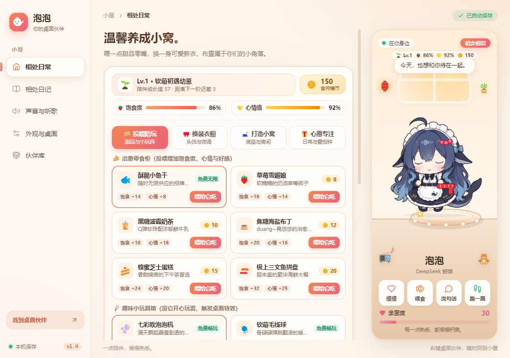
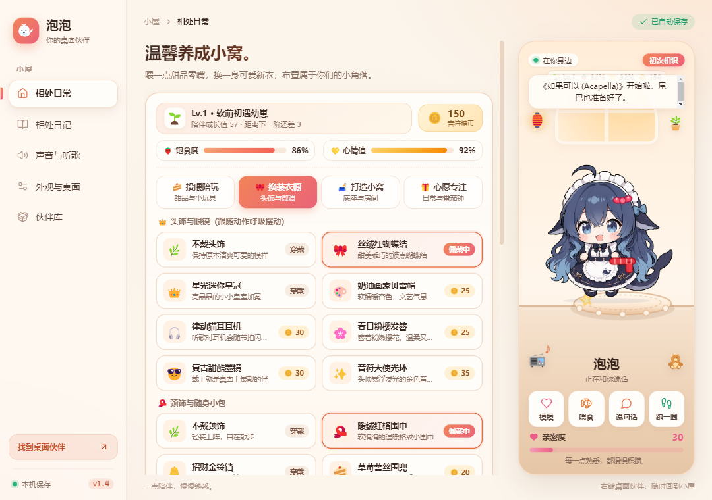
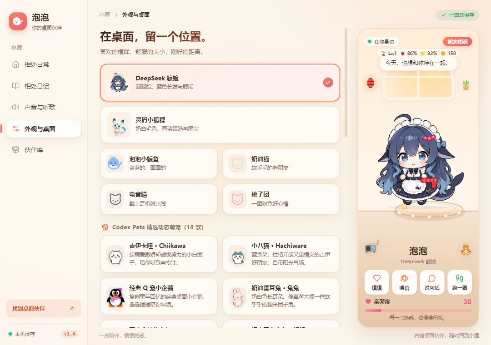
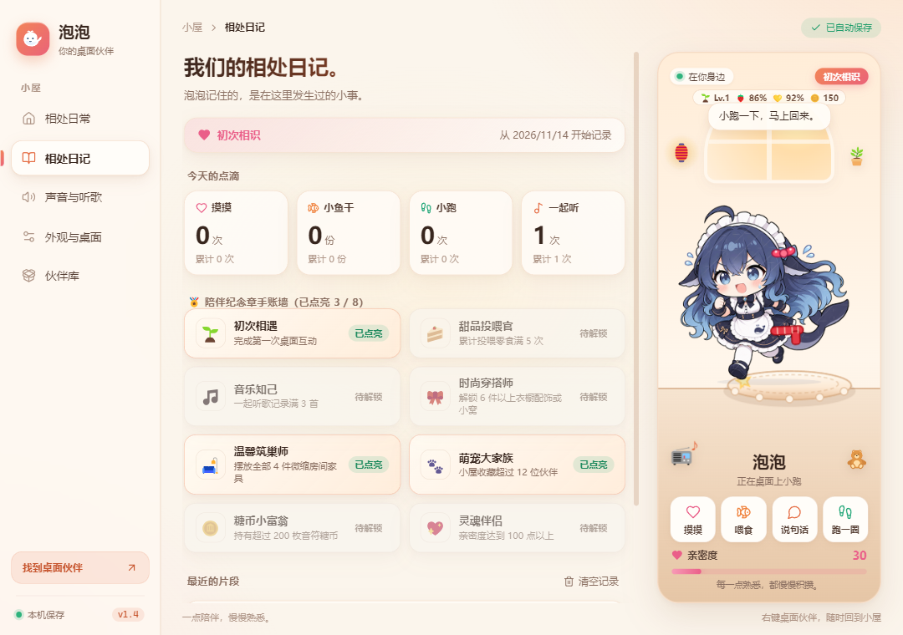

# 🐾 泡泡桌面伙伴 · MelodyPet (奶油手账风桌面养成版)

[](https://github.com/wmuj/melody-pet/releases/latest)
[](LICENSE)
[](https://github.com/wmuj/melody-pet/releases/latest)

一款温暖治愈的 **Windows 音乐陪伴与虚拟宠物养成桌宠**。内置 **24 款动态萌宠**（6 款内置伙伴 + 18 款来自 Codex Pets 的 V2 11 动作全图集萌宠），支持 **甜品投喂、衣橱换装、桌面小窝与微缩房间布置、石头剪刀布与盲盒扭蛋、专注番茄钟、系统音频实时踩点律动、同步歌词气泡、本地中文语音回应** 与 **陪伴纪念章手账墙**。

> 📦 **免安装绿色版直接下载**：前往 [**GitHub Releases 页面**](https://github.com/wmuj/melody-pet/releases/latest) 下载 `MelodyPet-v1.5.0-win-x64-Portable.zip`，解压后双击 `泡泡桌面伙伴.exe` 即可直接运行（无需安装 Node.js 环境）。

---

## 📸 界面与玩法预览

| 🍰 温馨养成小窝 · 甜品投喂与陪玩 | 🎀 换装衣橱 · 14 件配饰与微缩房间 |
| :---: | :---: |
|  |  |
| **🐾 24 款全动作萌宠画廊（6 内置 + 18 Codex V2）** | **🏅 相处日记 · 陪伴纪念章手账墙** |
|  |  |

---

## ✨ 核心亮点

- **🐾 24 款全动作萌宠随心切换**：
  - **6 款内置伙伴**：DeepSeek 鲸娘、灵码小狐狸、泡泡小鲸鱼、奶油猫、电音喵、桃子团。
  - **18 款内置 Codex V2 全动作萌宠**（配备 144 条角色专属口头禅）：吉伊卡哇 (Chiikawa)、小八猫 (Hachiware)、经典 Q 宠小企鹅、奶油垂耳兔、围巾金丝熊仓鼠、糯米团白仓鼠舒舒、佛系卡皮巴拉、破壳企鹅宝宝、雪团北极小狐、元气小奶狗、鸭顶顶小熊猫、水手裙大肥鱼、蓝鲸女仆薇拉、卡西法暖心火苗、童年记忆烧香小熊猫、克莱因猫猫、暗夜哥特黑鲸娘、星际舰长大肥鱼。
- **🍰 温馨养成系统（喂食 · 陪玩 · 换装 · 筑巢）**：
  - **6 种美味零嘴 & 4 种互动玩具**：香脆小鱼干、草莓雪媚娘、黑糖珍珠奶茶、焦糖布丁、草莓奶油蛋糕、三文鱼寿司；七彩泡泡机、粉粉毛线球、星光逗宠棒、八音盒水晶球。
  - **14 件可穿戴配饰（支持高低与缩放微调）**：草莓蝴蝶结、小王子皇冠、画家贝雷帽、律动猫耳耳机、春日樱花簪、酷盖墨镜、音符天使光环；暖绒红格围巾、招财金铃铛、蕾丝小围兜、星空领结、小黄鸭斜挎包。
  - **5 款桌面小窝底座 & 4 款微缩房间窗景**：奶油云朵软垫、珍珠贝壳海景窝、复古黑胶音乐毯、森系抹茶榻榻米、星月棉花糖云窝；搭配留声机、龟背竹、奶油蘑菇灯、焦糖泰迪熊家具自由摆放。
- **🎲 趣味游艺机 & 陪伴手账**：
  - **石头剪刀布 & 幸运盲盒扭蛋机**：和伙伴猜拳赚取音符糖币，扭蛋抽取限定装扮或糖果福袋。
  - **今日小确幸任务 & 陪伴番茄钟**：每日 3 项小互动拆 +60 🪙 礼盒；15/25/45 分钟专注倒计时与 45 分钟温柔喝水提醒。
  - **8 枚陪伴纪念章手账墙**：记录真实摸摸、喂食、小跑与听歌历史，点亮专属成就勋章。
- **🎵 音乐联动 & 贴心系统体验**：
  - 支持 Windows SMTC 媒体识别、同步歌词气泡、系统内录实时踩点律动、离线 Windows 原生中文语音合成。
  - 支持 **桌面右键直接切换 24 款萌宠**、**全局老板键 (`Alt + Q`) 一秒隐藏/唤回**、**开机自动陪伴**，以及一键生成免安装便携版（`npm run package`）。

---

## 🚀 快速开始

双击 **启动泡泡桌宠.bat** 或 **启动泡泡.vbs** 即可直接打开桌宠。也可以通过命令行构建与打包免安装独立版：

```powershell
npm install
npm run compile:helper
npm run build
npm test
npm run package
```

---

## 📖 历史版本说明

蓝发、白色头饰、女仆裙和完整鲸尾的「大肥鱼」鲸娘。会在桌面上跑动，摸摸、喂食、听歌时用本地中文声音回应，也会记录在这里发生过的相处片段。

1.4 新增用户本地 Codex 的「灵码小狐狸」：奶白毛色、青蓝眼睛和蓝色尾尖。在小屋的「伙伴库」点击灵码旁的「使用」，也可以通过「外观与桌面」或桌宠右键菜单切换。原始 1536×2288 的 V2 动画图集随项目保存，运行不依赖 Codex 或在线素材地址；鲸娘和其他伙伴继续保留，昵称、亲密度、日记及声音等偏好不重置。

灵码采用原图集的待机、左右跑步、挥手、跳跃、表情和十六方向视线；喂食与爱心由现有互动渲染器叠加，睡眠使用原图中闭眼低头的姿态配合呼吸和睡眠标记。接入记录见 [灵码小狐狸接入与验收](docs/灵码小狐狸接入与验收.md)。

灵码会使用对应的狐狸、耳朵与蓬松尾巴台词；昵称、真实歌名和自定义台词保持原样。构建和 11 项测试通过，实际 Electron 的切换、互动、视线、三种尺寸、最小窗口及重启保留验证见上述记录。

1.3 按用户新提供的截图，采用圆脸、深蓝灰长发和短身形的鲸娘。小屋参考 Claude 的视觉风格，改为暖白背景、炭灰文字和陶土色强调；使用左侧导航、中间设置、右侧互动预览。参考原图保留在 `references/user-selected-whale-20261113.png`。

默认形象使用 984×984 待机／表情图和约 640 像素的独立互动姿态，按显示器实际像素密度绘制。呼吸、眨眼、口型、跑步形变、拎起和落地由程序驱动；这是高清姿态配合程序动画，尚不是一套重新绘制的完整逐帧动画。

本项目是本地 Windows 桌面应用，基于 Electron、React、TypeScript、Canvas 和 Windows 原生媒体 / 语音接口。

## 现在怎么玩

双击 **启动泡泡.vbs**，直接打开桌宠，不显示命令行窗口。原来的 **启动音律桌宠.bat** 也可以继续用。重复启动会显示已有伙伴并打开小屋。

- 单击身体：摸摸头、握手或碰尾巴，触摸区域有不同回应，好感 +1。
- 鼠标靠近：暂停散步，显示喂食、说话、跑一圈、静音和小屋按钮。
- 喂食：小鱼干靠近后切换吃饱姿态，好感 +5；两分钟内吃过三份后会表示吃饱，不再重复加分和计数。
- 说句话：根据触摸、喂食、时段和实际相处记录选择中文短句，避免重复近期 12 条；切歌播报有防打断和冷却。
- 跑一圈：切换跑步姿态，在当前显示器内实际移动；即使关闭自由散步，也能单独触发。
- 拎起来：按住身体拖动，松手有惯性；可在小屋关闭边缘吸附。
- 右键：打开操作菜单，可以睡觉、唤醒、隐藏或打开小屋。
- 双击身体：尝试唤起已支持的音乐播放器窗口。

小屋左侧有「相处日常」「相处日记」「声音与听歌」「外观与桌面」「伙伴库」五页，支持上下方向键、Home / End 切换。右侧伙伴预览可以直接摸摸、喂食、说话和跑一圈。设置自动保存，失败时明确提示；导入启用失败时不会误报成功。桌面工具按钮与迷你播放条在悬停时出现，位于角色下方。

相处日记保存实际的摸摸、喂食、说话、小跑，以及播放器连续报告播放十秒后的一起听歌事件。旧版亲密度不会被编造成历史互动。可取消或确认清空日记，昵称、亲密度、声音和其他偏好仍然保留。

## 语音与散步

中文出声使用 `native/bin/voice-bridge.exe` 调用本机 Windows 语音引擎，无需模型账号，不发送台词到远程语音服务。可选声线、音量、语速，也能立即静音。新的互动会替换上一句话，不会排队念很久。

可用声线以小屋实际枚举结果为准。本机这次原生助手识别到了「Microsoft Huihui Desktop」中文声音和两个英文声音；系统不同，列表会不同。嘴巴随说话状态开合，属于表现动画，不是逐音素口型对齐。

自由散步会走走停停，在当前显示器工作区左右折返，保留你拖放的高度。靠近、拖拽、说话、睡觉、隐藏时会停下。没有播放音乐且两分钟没互动，会小睡；开启散步时，自动小睡约四十秒后醒来。手动点「睡个小觉」会一直休息，直到摸摸、投喂、唤醒或跑一圈。

## 听歌与形象

通过 Windows SMTC 获取支持该接口的播放器提供的歌曲和播放状态。不是所有播放器都提供完整信息；通用媒体控制取决于对应会话。唤起窗口目前针对网易云、QQ 音乐和 Spotify。

只有播放器提供有效时长和进度时，才按歌名与歌手向网易云音乐接口或 LRCLib 查询同步歌词；可能没有结果或匹配不准，可在小屋关闭。歌词会过滤“作词／作曲”等制作名单。

此前验证的网易云会话能提供真实曲名、歌手和播放状态，但其 SMTC 进度与时长均为 0。遇到这种情况会保留曲名和控制入口，暂不显示同步歌词，避免歌词长期停在第一行；不据此宣称这个客户端已支持准确歌词跟随。未连接播放器时，小屋会显示等待播放提示。系统内录有声音时才分析频谱，没有实际音频信号时不会伪造节拍。语音互动无需在线歌词服务。

内置高清鲸娘、原蓝色小鲸鱼、奶油猫、电音喵、桃子团。也可导入 WebM / GIF / PNG / WebP 等素材。素材会复制到用户数据目录，原文件保留；只放一个待机文件也能使用。视频使用双槽预加载，具体透明度和解码兼容性取决于素材，未对所有第三方视频包作兼容保证。

「伙伴库」支持从 [Codex Pets](https://codex-pets.net/) 下载的 V1／V2 ZIP 或解压后的 `pet.json`。导入时校验元数据、包内路径、大小和图集尺寸，图片可解码后再启用。此类图集每格为 192×208，放大显示会损失清晰度；导入格式支持不代表所有社区帧图本身都没有缺陷。默认高清鲸娘使用独立 PNG，不使用低分辨率图集。

角色图像来自用户指定的社区仓库，具体来源、修改与上游使用条件见 [THIRD_PARTY_NOTICES.md](THIRD_PARTY_NOTICES.md)。当前是本机个人原型，不能把程序许可当作所有角色图片的公开分发许可。

## 开发与验证

```powershell
npm install
npm run compile:helper
npm run build
npm test
npm start
```

`npm run build` 会同时检查前端和 Electron 的 TypeScript。`npm run dev` 使用本机 Vite 服务，前端修改可热更新；修改主进程或原生助手后需要重新启动。

原生助手用 Windows .NET Framework 的 C# 编译器构建。如果助手源码有变化，先退出正在运行的对应桌宠，再编译；无变化时会复用已有程序。

自动测试覆盖设置兼容、无效设置、工作区边界折返、声线回退、真实原生中文语音合成、日记持久化／跨日／清空、连续播放记录、台词避重复、无进度歌词回退以及 Codex 图集导入校验。语音测试生成 PCM WAV 并检查时长和非静音数据。

1.3 的实际 Electron 功能、视觉与错误恢复检查见 [Claude 风格改版与验收](docs/Claude风格改版与验收.md) 和 `artifacts/claude-redesign-qa/`。1.2 的 [鲸娘升级与验收](docs/鲸娘升级与验收.md)、[验证记录](docs/验证记录.md) 与 `artifacts/whalegirl-qa/`，以及 1.1 的 `artifacts/whale-qa/` 均保留为历史证据。

## 数据与备份

正常使用的数据位于 `%APPDATA%\melody-pet`：

- `melody-pet-settings.json`：昵称、外观、好感、语音、散步和窗口设置。
- `pet-packs/`：导入的伙伴素材。
- `companion-memory.json`：实际相处片段与累计次数；保留最近 240 条事件、90 天每日计数，界面显示最近 40 条事件。
- `melody-pet-settings.json.v1-backup`／`.v2-backup`：首次升级相应旧版设置时保留的原件。

从 1.1（设置格式 2）升级到 1.2 时，设置格式变为 3。使用默认内置小鲸鱼时迁移为高清鲸娘，保留昵称、好感、声音、窗口偏好和导入素材；其他内置外观及第三方素材选择继续保留。原小鲸鱼和三套猫咪仍可切换。

1.3 开发前源码备份位于 `backups/before-claude-redesign-20261113-144729/`；之前两轮备份仍保留。当前测试使用独立数据目录 `artifacts/claude-redesign-qa/profile/`，不混用日常设置与互动次数。设置格式仍为 3，升级界面不会重置昵称、亲密度、声音或外观偏好。

本项目尚未制作独立安装包；当前启动器使用项目中的 Electron 运行时。
